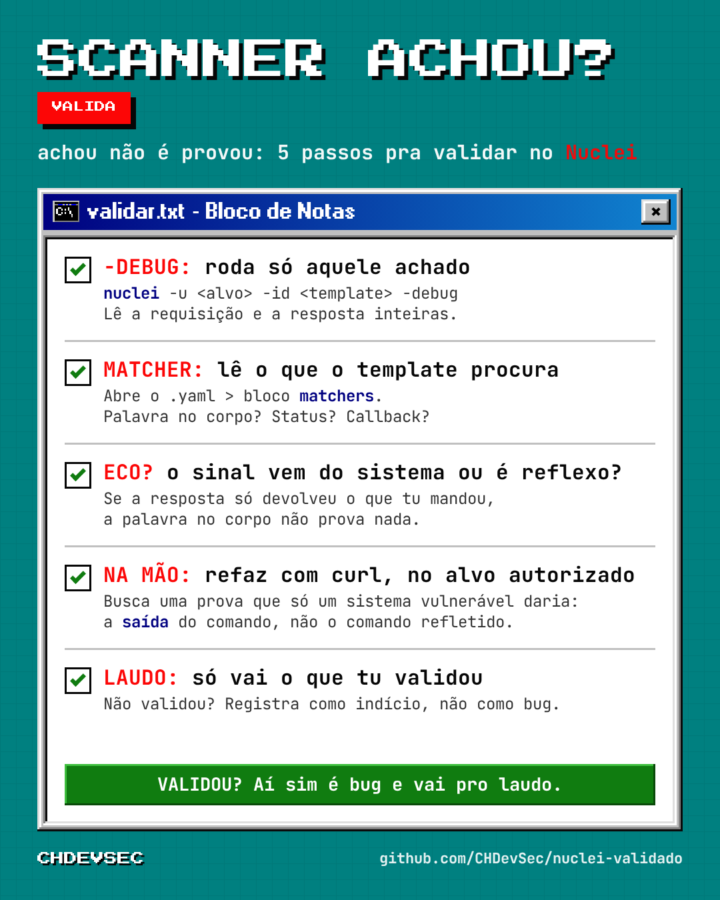

# nuclei-validado

**Scanner achou não é scanner provou. Aqui tu vê o Nuclei acusar um "RCE crítico" num
servidor que não executa nada, e aprende a validar um achado antes de chamar de bug.**

Lab da [CHDEVSEC](https://chdevsec.com.br). O foco é **validação e ética**: tudo roda numa
**isca local** (um servidor de 30 linhas que só devolve o que recebe), numa rede Docker
isolada, sem tocar em sistema de ninguém. Ver [ETICA.md](ETICA.md).



Baixa o card em [PNG](defesa/nuclei-card.png) ou [PDF](defesa/nuclei-card.pdf).
**Checklist de validação:** [`defesa/checklist.md`](defesa/checklist.md)

## O que este repo É
- Uma **isca local** ([`lab/isca.py`](lab/isca.py)) que responde `200 OK` pra tudo e devolve
  no corpo a requisição inteira (eco). Igual ao servidor isca do vídeo.
- O **Nuclei** (imagem oficial `projectdiscovery/nuclei`) rodando contra ela, sem callback pra
  fora (`-ni`).
- O passo a passo pra **validar** o que ele acusou, com `-debug` e lendo o template.

## O que este repo NÃO é
- Não é tutorial pra escanear site dos outros. Scanner em alvo sem autorização é crime.
  O lab só aponta pra `http://isca:8080`, dentro do teu Docker.

## Mostra rápido (uns 2 minutos)

Precisa de Docker com Compose.

```bash
cd lab
docker compose up --abort-on-container-exit   # isca + Nuclei (templates cve, critical/high)
cat resultados/scan.jsonl                     # o que ele acusou
./validar.sh                                  # roda SÓ o achado com -debug e mostra a prova
```

Na nossa rodada (15/nov/2026, templates do dia) o Nuclei acusou **1 crítico**:
`CVE-2026-77806` (*SPIP < 4.4.22, Unauthenticated RCE*). Contra uma isca que não tem SPIP e
não executa nada. O resultado pode variar conforme os templates mudam: a lição não muda.

## O que aconteceu (e por que é falso positivo)

O template faz duas checagens, e o eco engana as duas:

1. **"Isso é SPIP?"** Faz `GET /spip.php` e procura `spip.php` no corpo. A isca devolve o
   próprio request, que contém `spip.php`. Passou.
2. **"Executou o comando?"** Faz um `POST` com `0=echo <marcador>` e procura o marcador no
   corpo. A isca devolve o request de novo, com o marcador dentro. Passou.

O `./validar.sh` mostra a resposta de verdade:

```text
HTTP/1.0 200 OK
Server: isca-lab
...
POST /spip.php?page=sommaire&GhNDewNF=%3C%3Fphp%20header(...) HTTP/1.1
0=echo bQhLJ0kA
```

A resposta tem **o comando** (`echo bQhLJ0kA`), não **a saída** dele. Num RCE de verdade,
viria só `bQhLJ0kA`, sem o `echo` e sem o request inteiro em volta. **Achou, não provou.**

## Como validar qualquer achado (4 passos)

1. **Roda só aquele achado com `-debug`** (`-id <template>`): olha a requisição e a resposta
   de verdade, não o resumo.
2. **Lê o matcher no template** (`.yaml`): o que exatamente ele considerou "vulnerável"? Uma
   palavra no corpo? Um status? Um callback?
3. **Pergunta se o sinal vem do sistema ou é reflexo:** a resposta só devolveu o que tu mandou?
   O callback veio de onde? O servidor parece mesmo ser o produto que o template procura
   (cabeçalhos, versão, páginas)?
4. **Refaz na mão** (curl/navegador), no alvo **autorizado**, com uma prova que só um sistema
   vulnerável de verdade daria. Validou? Aí sim é bug, e vai pro laudo com evidência.

Detalhes: [`defesa/checklist.md`](defesa/checklist.md).

## O caso do vídeo
No vídeo, o Nuclei gritou **32 críticos e altos em menos de dois minutos** contra um servidor
isca. Os CVEs são reais; o que era isca era o alvo. Validando com `-debug`: o servidor devolvia
tudo que recebia e chamava de volta o endereço de teste do Nuclei, com cara de nenhum dos
produtos acusados. Dados e explicação: [`caso-do-video.md`](caso-do-video.md).

## Licença
MIT, ver [LICENSE](LICENSE). Feito pela CHDEVSEC pra ensino de segurança na prática.
